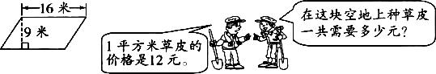

# Mathematics (Grade 5)

**ID**: 6661088d
**难度**: medium_easy
**题型**: short_answer

## 题目
东山小区要在下图中的这块平行四边形空地上种草皮．

## 解答

**答案**: 144平方米, 1728元

1. Step1:根据平行四边形面积公式S = 底×高，此平行四边形空地的底是16米，高是9米，可得面积为16×9 = 144平方米
2. Step2:已知1平方米草皮价格是12元，已求出空地面积为144平方米，那么种草皮总费用为144×12 = 1728元

## 知识点

**知识点**:
  - 

---
