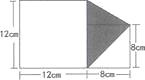

# Mathematics (Grade 5)

**ID**: 6bf9b498
**难度**: medium_easy
**题型**: short_answer

## 题目
计算下面图形中阴影部分的面积

## 解答

**答案**: 48平方厘米

1. Step1:观察图形可知阴影部分是一个三角形
2. Step2:三角形的底为8厘米
3. Step3:三角形的高为12厘米
4. Step4:根据三角形面积公式S = 底×高÷2，可得该阴影部分面积为12×8÷2
5. Step5:计算12×8÷2的结果为48平方厘米

## 知识点

**知识点**:
  - 

---
