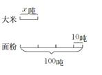

# Mathematics (Grade 5)

**ID**: 7e940722
**难度**: medium_easy
**题型**: short_answer

## 题目
看图列方程。

## 解答

**答案**: 30

1. Step1:设大米有x吨，从图中可知面粉的重量是大米重量的3倍还多10吨，面粉重100吨，可列方程3x + 10 = 100
2. Step2:求解方程3x + 10 = 100，先移项得到3x = 100 - 10
3. Step3:计算100 - 10 = 90，此时方程变为3x = 90
4. Step4:两边同时除以3，即x = 90÷3
5. Step5:计算90÷3 = 30，得出x = 30
6. Step6:题目所求为x的值，所以答案是30

## 知识点

**知识点**:
  - 小学数学;数与代数;应用题;常见的数学问题;图文问题

---
