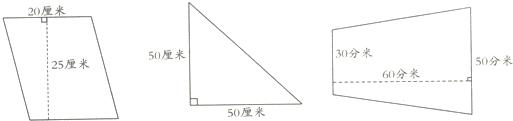

# Mathematics (Grade 5)

**ID**: a23ed55d
**难度**: medium_easy
**题型**: short_answer

## 题目
计算下面图形的面积．

## 解答

**答案**: 500, 1250, 2400

1. Step1:根据平行四边形面积公式，底为20厘米，高为25厘米，可得面积为20×25 = 500平方厘米
2. Step2:根据三角形面积公式，底为50厘米，高为50厘米，可得面积为50×50÷2 = 1250平方厘米
3. Step3:根据梯形面积公式，上底为30分米，下底为50分米，高为60分米，先计算(30 + 50)×60÷2 = 80×30 = 2400平方分米

## 知识点

**知识点**:
  - 平行四边形的面积；三角形的周长和面积；梯形的面积．

---
