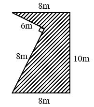

# Mathematics (Grade 5)

**ID**: b0f7c72e
**难度**: medium_easy
**题型**: short_answer

## 题目
给这块地铺上草坪(如图阴影部分)，每平方米草坪要10元钱，共要花多少元?

## 解答

**答案**: 560元

1. Step1:将图形看作一个上底为8m、下底为8m、高为10m的梯形减去一个底为6m、高为8m的三角形。
2. Step2:根据梯形面积公式S=(a + b)h÷2（其中a为上底，b为下底，h为高），计算梯形面积为(8 + 8)×10÷2 = 80平方米。
3. Step3:根据三角形面积公式S = ah÷2（其中a为底，h为高），计算三角形面积为6×8÷2 = 24平方米。
4. Step4:用梯形面积减去三角形面积得到阴影部分面积，即80 - 24 = 56平方米。
5. Step5:已知每平方米草坪要10元钱，那么总共花费为56×10 = 560元。

## 知识点

**知识点**:
  - 小学数学;数与代数;应用题;面积、体积相关应用题;组合图形应用题

---
