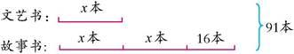

# Mathematics (Grade 5)

**ID**: cef15614
**难度**: medium_easy
**题型**: short_answer

## 题目
看图列方程。

## 解答

**答案**: 3x+16=91, x=25

1. Step1:观察图形可知，文艺书有x本，故事书有2个x本还多16本，两种书一共有91本，可列出方程3x + 16 = 91
2. Step2:求解方程3x + 16 = 91，先将方程两边同时减去16，得到3x = 91 - 16，即3x = 75
3. Step3:再将方程3x = 75两边同时除以3，解得x = 75÷3，即x = 25

## 知识点

**知识点**:
  - 小学数学;数与代数;式与方程;方程的解与解方程

---
