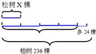

# Mathematics (Grade 5)

**ID**: e47ff7b6
**难度**: medium_easy
**题型**: short_answer

## 题目

## 解答

**答案**: 53

1. Step1:设松树棵数为x，根据线段图可知柏树的棵数是松树棵数的4倍多24棵，所以柏树棵数可表示为4x + 24
2. Step2:已知柏树236棵，那么可列方程4x + 24 = 236
3. Step3:方程两边同时减去24，得到4x = 236 - 24，即4x = 212
4. Step4:方程两边同时除以4，得到x = 212÷4，即x = 53

## 知识点

**知识点**:
  - 图文应用题．

---
