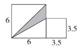

# Mathematics (Grade 5)

**ID**: f70b4cbc
**难度**: medium_easy
**题型**: short_answer

## 题目
求阴影部分的面积．(单位：cm)

## 解答

**答案**: 7.5

1. Step1:观察图形可知，阴影部分是一个三角形
2. Step2:该三角形的底为大正方形边长减去小正方形边长，即6 - 3.5
3. Step3:三角形的高为大正方形的边长6
4. Step4:根据三角形面积公式S = 底×高÷2，可得面积为(6 - 3.5)×6÷2
5. Step5:计算(6 - 3.5)×6÷2 = 7.5(cm²)

## 知识点

**知识点**:
  - 小学数学;图形与几何;平面图形;三角形;三角形的面积

---
