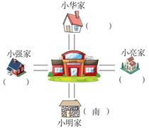

# Mathematics (Grade 5)

**ID**: 0b507e49
**难度**: medium
**题型**: fill_in_the_blank

## 题目
小明、小亮、小强、小华住在学校的四个不同方向。小明从学校出发向南走就是自己的家。请你根据小明家的方向，分别填出小强家、小华家和小亮家分别在学校的什么方向。

## 解答

**答案**: 北, 西, 东

1. Step1:已知小明从学校出发向南走就是自己的家，所以学校在小明家的北面。
2. Step2:因为小明、小亮、小强、小华住在学校的四个不同方向，以学校为中心建立方位概念，上北下南左西右东。
3. Step3:根据方位关系，小强家在学校的左边，即西方。
4. Step4:小华家在学校的上面，即北方。
5. Step5:小亮家在学校的右边，即东方。

## 知识点

**知识点**:
  - 

---
