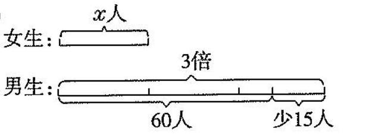

# Mathematics (Grade 5)

**ID**: 3a0942cd
**难度**: medium
**题型**: fill_in_the_blank

## 题目

 女生  x人   男生   3倍   60人   少15人
 列方程：______

## 解答

**答案**: 3x-15=60

1. Step1:根据图中信息可知女生人数为x人
2. Step2:因为男生人数是女生人数的3倍少15人，所以男生人数可表示为3x - 15
3. Step3:又已知男生人数为60人
4. Step4:根据男生人数的两种表达方式可列出方程3x - 15 = 60

## 知识点

**知识点**:
  - 课时全练全测;简易方程;解方程

---
