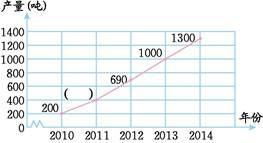

# Mathematics (Grade 5)

**ID**: 3aa99863
**难度**: medium
**题型**: fill_in_the_blank

## 题目
下图是2010年~2014年鹿野化肥厂产量增长情况统计图,看图填空。

(1)该厂2011年生产化肥（____）吨。
(2)2013年的产量是2010年的产量的（____）倍。
(3)2010年到2014年化肥的产量整体呈（____）趋势。

## 解答

**答案**: 400, 5, 上升

1. Step1:观察统计图，找到2011年对应的产量数值为400吨，所以该厂2011年生产化肥400吨
2. Step2:从统计图可知2013年产量是1000吨，2010年产量是200吨，1000÷200 = 5，所以2013年的产量是2010年的产量的5倍
3. Step3:观察2010 - 2014年统计图中产量的变化，产量数值从200吨逐步增加到1300吨，所以2010年到2014年化肥的产量整体呈上升趋势

## 知识点

**知识点**:
  - 小学数学;统计和概率;统计;统计图;单式折线统计图

---
