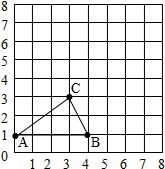

# Mathematics (Grade 5)

**ID**: 3cae83fe
**难度**: medium
**题型**: fill_in_the_blank

## 题目
如图三角形顶点B的位置为（4，1），A点位置为（，），C点为（，）．

## 解答

**答案**: 0, 1, 3, 3

1. Step1:根据数对表示位置的方法，第一个数字表示列，第二个数字表示行，观察图中A点在第0列第1行，所以A点位置用数对表示为（0，1）
2. Step2:再观察图中C点在第3列第3行，所以C点位置用数对表示为（3，3）

## 知识点

**知识点**:
  - 数对与位置．

---
