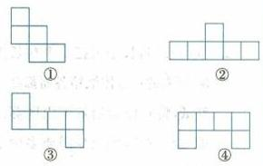

# Mathematics (Grade 5)

**ID**: 3e2f9a5a
**难度**: medium
**题型**: fill_in_the_blank

## 题目
下列图形中，哪些能围成正方体？

 能围成正方体的图形有（）

## 解答

**答案**: ③

1. Step1:明确题目要求是判断哪些图形能围成正方体
2. Step2:依据正方体展开图的知识对图形①进行判断，得出不能围成正方体的结论
3. Step3:依据正方体展开图的知识对图形②进行判断，得出不能围成正方体的结论
4. Step4:依据正方体展开图的知识对图形③进行判断，得出能围成正方体的结论
5. Step5:依据正方体展开图的知识对图形④进行判断，得出不能围成正方体的结论
6. Step6:整理能围成正方体的图形为③，确定答案为['③']

## 知识点

**知识点**:
  - 长方体和正方体;正方体表面积

---
