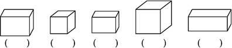

# Mathematics (Grade 5)

**ID**: 5194bd62
**难度**: medium
**题型**: fill_in_the_blank

## 题目
下xià面miàn的de图tú形xínɡ是shì长chánɡ方fānɡ体tǐ的de在zài下xià面miàn的de(  )里lǐ画huà“√”,是shì正zhènɡ方fānɡ体tǐ的de在zài下xià面miàn的de(  )里lǐ画huà“○”。

## 解答

**答案**: √, ○, √, ○, √

1. Step1:观察第一个图形，根据长方体和正方体的特征判断其为长方体，所以在第一个括号里画‘√’
2. Step2:观察第二个图形，判断其为正方体，在第二个括号里画‘○’
3. Step3:观察第三个图形，判断其为长方体，在第三个括号里画‘√’
4. Step4:观察第四个图形，判断其为正方体，在第四个括号里画‘○’
5. Step5:观察第五个图形，判断其为长方体，在第五个括号里画‘√’

## 知识点

**知识点**:
  - 

---
