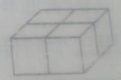

# Mathematics (Grade 5)

**ID**: 5deb7906
**难度**: medium
**题型**: fill_in_the_blank

## 题目
用4个完全相同的正方体拼成一个长方体（如图），表面积减少了32cm²，每个小正方体的表面积是(    )cm²。

## 解答

**答案**: 24

1. Step1:分析可知4个完全相同的正方体拼成一个长方体，表面积减少了8个正方形面的面积
2. Step2:由表面积减少了32cm²，可得一个正方形面的面积为32÷8 = 4cm²
3. Step3:因为正方体有6个面且都相同，所以每个小正方体的表面积为4×6 = 24cm²

## 知识点

**知识点**:
  - 

---
