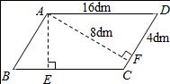

# Mathematics (Grade 5)

**ID**: 72ee5525
**难度**: medium
**题型**: fill_in_the_blank

## 题目
如图，求▱ABCD的高AE是多少分米？

## 解答

**答案**: 2

1. Step1:根据平行四边形面积公式s = ah，以底为4分米，高为8分米，可得面积为4×8 = 32平方分米
2. Step2:已知平行四边形另一条底为16分米，用面积32平方分米除以这条底16分米，即32÷16 = 2分米，此结果即为高AE的长度

## 知识点

**知识点**:
  - 平行四边形的面积

---
