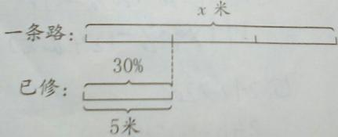

# Mathematics (Grade 5)

**ID**: 79bb35a0
**难度**: medium
**题型**: fill_in_the_blank

## 题目
看图列方程：(不解方程)

 一条路:   x米   30%  已修:   5 米

## 解答

**答案**: 30%·x=5

1. Step1:设这条路的长度为x米
2. Step2:因为已修的部分是全长的30%，所以已修的长度可表示为30%·x
3. Step3:已知已修的长度是5米
4. Step4:根据已修长度的两种表达方式可列方程30%·x=5

## 知识点

**知识点**:
  - --

---
