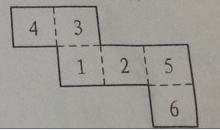

# Mathematics (Grade 5)

**ID**: a0f4d02f
**难度**: medium
**题型**: fill_in_the_blank

## 题目
右图是一个长方体的展开图，在正方体中，与1号面相对的是（）号面，与2号面相对的是（）号面，与3号面相对的是（）号面.

## 解答

**答案**: 5, 4, 6

1. Step1:观察长方体展开图，根据正方体表面展开图相对面不相邻的特征，可知1号面与2号、3号、4号面相邻，所以与1号面相对的是5号面
2. Step2:同样根据相对面不相邻的特征，2号面与1号、3号、5号面相邻，所以与2号面相对的是4号面
3. Step3:还是依据相对面不相邻的特征，3号面与1号、2号、4号面相邻，所以与3号面相对的是6号面

## 知识点

**知识点**:
  - --

---
