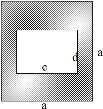

# Mathematics (Grade 5)

**ID**: e639bfa8
**难度**: medium
**题型**: fill_in_the_blank

## 题目
拓展题：用含有字母的式子表示图中阴影部分的面积．

## 解答

**答案**: a^2-cd

1. Step1:明确图形组成，图中包含一个边长为a的正方形和一个长为c、宽为d的长方形。
2. Step2:根据正方形面积公式，边长为a的正方形面积为a**2。
3. Step3:根据长方形面积公式，长为c、宽为d的长方形面积为c*d。
4. Step4:求阴影部分面积，用正方形面积减去长方形面积，即a**2 - c*d。

## 知识点

**知识点**:
  - 长方形、正方形的面积；用字母表示数．

---
