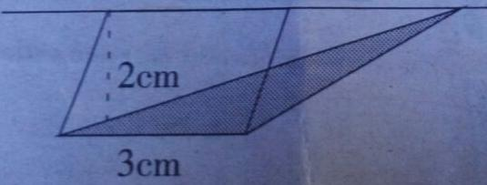

# Mathematics (Grade 5)

**ID**: f859d94b
**难度**: medium
**题型**: fill_in_the_blank

## 题目
如图所示，涂色三角形的面积是（    ）平方厘米.

 2cm   3cm

## 解答

**答案**: 3

1. Step1:明确三角形面积公式为三角形面积=底×高÷2
2. Step2:由图可知该涂色三角形的底是3厘米
3. Step3:由图可知该涂色三角形的高是2厘米
4. Step4:将底3厘米和高2厘米代入三角形面积公式，计算3×2÷2
5. Step5:先计算3×2=6
6. Step6:再计算6÷2=3，得出涂色三角形面积是3平方厘米

## 知识点

**知识点**:
  - --

---
