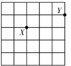

# Mathematics (Grade 5)

**ID**: 038b5974
**难度**: medium_hard
**题型**: fill_in_the_blank

## 题目
如图：如果点X的位置表示为（2，3），则点Y的位置可以表示为（）。

## 解答

**答案**: 5, 4

1. Step1:根据点X的位置（2，3），确定2表示第2列，3表示第3行
2. Step2:观察图形，确定点Y在第5列
3. Step3:观察图形，确定点Y在第4行
4. Step4:得出点Y的位置用数对表示时，第一个数为5
5. Step5:得出点Y的位置用数对表示时，第二个数为4

## 知识点

**知识点**:
  - 用数对确定位置

---
