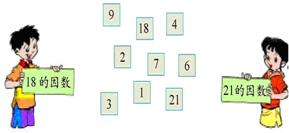

# Mathematics (Grade 5)

**ID**: 03ae9105
**难度**: medium_hard
**题型**: fill_in_the_blank

## 题目
看谁找的快

（1）18的全部因数有1、2、3、6、9，还有$\underline{\hspace{5em}}$
（2）21的全部因数有1、3、7，还有$\underline{\hspace{5em}}$
（3）即是18的因数又是21的因数有1，还有$\underline{\hspace{5em}}$．

## 解答

**答案**: 18, 21, 3

1. Step1:根据找因数的方法，一个数最小的因数是1，最大的因数是它本身，18的因数中还缺少最大因数18，所以18的全部因数有1、2、3、6、9、18
2. Step2:同理，21的因数中还缺少最大因数21，所以21的全部因数有1、3、7、21
3. Step3:找出18的因数1、2、3、6、9、18和21的因数1、3、7、21中相同的数，除了1外，还有3，所以即是18的因数又是21的因数有1和3

## 知识点

**知识点**:
  - 找一个数的因数的方法；求几个数的最大公因数的方法．

---
