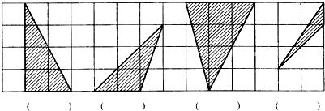

# Mathematics (Grade 5)

**ID**: 05073ec7
**难度**: medium_hard
**题型**: fill_in_the_blank

## 题目
求如图所示阴影三角形的面积各为多少．（每格是边长为1厘米的小正方形．） 

## 解答

**答案**: 4, 3, 6, 1

1. Step1:对于第一个三角形，数出其底为2厘米，高为4厘米，根据三角形面积公式S = 底×高÷2，可得其面积为2×4÷2 = 4平方厘米
2. Step2:对于第二个三角形，数出其底为2厘米，高为3厘米，根据三角形面积公式可得其面积为2×3÷2 = 3平方厘米
3. Step3:对于第三个三角形，数出其底为3厘米，高为4厘米，根据三角形面积公式可得其面积为3×4÷2 = 6平方厘米
4. Step4:对于第四个三角形，数出其底为1厘米，高为2厘米，根据三角形面积公式可得其面积为1×2÷2 = 1平方厘米
5. Step5:将四个三角形面积依次整理为列表['4', '3', '6', '1']

## 知识点

**知识点**:
  - 三角形的周长和面积．

---
