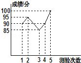

# Mathematics (Grade 5)

**ID**: 065e5cd8
**难度**: medium_hard
**题型**: fill_in_the_blank

## 题目
如图是小华五次数学测验成绩的统计图。小华五次测验的平均分是（________）分。

## 解答

**答案**: 92

1. Step1:根据折线统计图获取小华五次数学测验的成绩分别为90分、95分、85分、90分、100分
2. Step2:计算五次成绩的总和，即90+95+85+90+100=460分
3. Step3:用总成绩除以测验次数5，即460÷5=92分，得到平均分

## 知识点

**知识点**:
  - 

---
