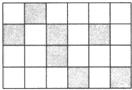

# Mathematics (Grade 5)

**ID**: 13c30a45
**难度**: medium_hard
**题型**: fill_in_the_blank

## 题目
如图是一个黑白小方块相同的长方形，李军用一个小球在上面随意滚动，落在
黑色方块的可能性为______．

## 解答

**答案**: $\frac{7}{24}$

1. Step1:数出图中黑色方块的数量为7个
2. Step2:数出图中总方块的数量为24个
3. Step3:用黑色方块的数量7除以总方块的数量24，即7÷24得到落在黑色方块的可能性为$\frac{7}{24}$

## 知识点

**知识点**:
  - 简单事件发生的可能性求解．

---
