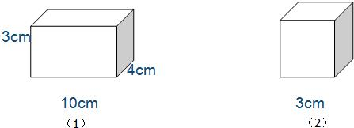

# Mathematics (Grade 5)

**ID**: 1488558c
**难度**: medium_hard
**题型**: fill_in_the_blank

## 题目
计算如图立体图形的体积．（单位：cm）

（1）$\underline{\hspace{5em}}$      ；（2）$\underline{\hspace{5em}}$      ．

## 解答

**答案**: 120立方厘米, 27立方厘米

1. Step1:明确图（1）是长方体，其长为10cm，宽为4cm，高为3cm，根据长方体体积公式V = abh（其中a为长，b为宽，h为高），可得其体积为10×4×3
2. Step2:计算10×4×3 = 40×3 = 120，单位为立方厘米，所以图（1）长方体体积为120立方厘米
3. Step3:明确图（2）是正方体，其棱长为3cm，根据正方体体积公式V = a³（其中a为棱长），可得其体积为3×3×3
4. Step4:计算3×3×3 = 9×3 = 27，单位为立方厘米，所以图（2）正方体体积为27立方厘米

## 知识点

**知识点**:
  - 长方体和正方体的体积

---
