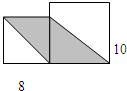

# Mathematics (Grade 5)

**ID**: 14b18bc0
**难度**: medium_hard
**题型**: fill_in_the_blank

## 题目
如图，两个正方形的边长分别是8厘米和10厘米，阴影部分的面积是$\underline{\hspace{5em}}$．

## 解答

**答案**: 72平方厘米

1. Step1:明确阴影部分由左边阴影三角形和右边阴影三角形组成
2. Step2:计算左边阴影三角形的底和高，底和高均为小正方形的边长8厘米，根据三角形面积公式底×高÷2，可得其面积为8×8÷2=32平方厘米
3. Step3:计算右边阴影三角形的底为大正方形的边长10厘米，高为小正方形的边长8厘米，根据三角形面积公式底×高÷2，可得其面积为10×8÷2=40平方厘米
4. Step4:将左右两个阴影三角形面积相加，32+40=72平方厘米，得到阴影部分的面积

## 知识点

**知识点**:
  - 组合图形的面积．

---
