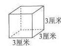

# Mathematics (Grade 5)

**ID**: 14e30944
**难度**: medium_hard
**题型**: fill_in_the_blank

## 题目

 3厘米 3厘米 3厘米
 （1）这个正方体的棱长是(   )
 （2）每个面的面积是(   )
 （3）这个正方体的表面积是(   )

## 解答

**答案**: 3, 9, 54

1. Step1:观察图形可知该物体是正方体，其棱长为3厘米
2. Step2:因为正方体每个面都是正方形，正方形面积=边长×边长，所以每个面的面积为3×3 = 9平方厘米
3. Step3:由正方体表面积公式棱长×棱长×6，已知棱长为3厘米，每个面面积为9平方厘米，所以表面积为9×6 = 54平方厘米

## 知识点

**知识点**:
  - 长方体和正方体;长方体和正方体的表面积

---
