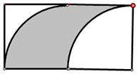

# Mathematics (Grade 5)

**ID**: 1cd8ac0f
**难度**: medium_hard
**题型**: fill_in_the_blank

## 题目
如图，已知长方形的面积是32平方厘米，阴影部分的面积是$\underline{\hspace{5em}}$      平方厘米．

## 解答

**答案**: 16

1. Step1:根据图形特点，可知图中①的面积=③的面积，②的面积=④的面积
2. Step2:由①的面积=③的面积，②的面积=④的面积，可推出①+②=③+④=②+③
3. Step3:得出阴影部分的面积等于长方形面积的一半
4. Step4:已知长方形面积是32平方厘米，计算32÷2=16平方厘米，即阴影部分面积为16平方厘米

## 知识点

**知识点**:
  - 组合图形的面积

---
