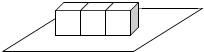

# Mathematics (Grade 5)

**ID**: 1e72b96e
**难度**: medium_hard
**题型**: fill_in_the_blank

## 题目
三个棱长为2分米的正方体放在桌面上，露在外面的面积是 $\underline{\hspace{5em}}$ 平方分米．

## 解答

**答案**: 56

1. Step1:计算拼成后的长方体的长，长为2×3 = 6分米，宽和高均为2分米
2. Step2:根据长方体表面积公式s=(ab + ah + bh)×2，其中a = 6分米，b = 2分米，h = 2分米，代入可得(6×2 + 6×2 + 2×2)×2
3. Step3:先计算括号内的值，6×2 = 12，6×2 = 12，2×2 = 4，所以括号内为12 + 12 + 4 = 28
4. Step4:再计算括号外的值，28×2 = 56，得到露在外面的面积为56平方分米

## 知识点

**知识点**:
  - 长方体和正方体的表面积

---
