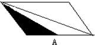

# Mathematics (Grade 5)

**ID**: 22b5bb90
**难度**: medium_hard
**题型**: fill_in_the_blank

## 题目
一个平行四边形底边中点是A，它的面积是48平方厘米，则黑色部分的面积为$\underline{\hspace{5em}}$厘米．

## 解答

**答案**: 12

1. Step1:根据平行四边形面积公式S = 底×高，由于A是底边中点，可知黑色部分三角形与同它相邻空白三角形等底等高
2. Step2:根据三角形面积公式S = 底×高÷2，等底等高的三角形面积相等，所以黑色部分面积和同它相邻的空白三角形面积相等
3. Step3:因为这两个三角形的和是平行四边形面积的一半，所以先计算平行四边形面积的一半，即48÷2 = 24平方厘米
4. Step4:又因为黑色部分面积和相邻空白三角形面积相等，所以黑色部分面积为24÷2 = 12平方厘米

## 知识点

**知识点**:
  - 三角形的周长和面积．

---
