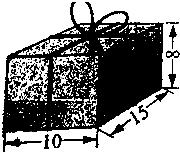

# Mathematics (Grade 5)

**ID**: 276f7926
**难度**: medium_hard
**题型**: fill_in_the_blank

## 题目
用10m长的绳子捆扎一种礼盒，如果结头处要用掉绳子25cm，这根绳子最多可以捆扎几个这样的礼盒？（单位：cm）

## 解答

**答案**: 9

1. Step1:将绳子长度单位由米换算为厘米，因为1米 = 100厘米，所以10米 = 10×100 = 1000厘米
2. Step2:计算捆扎一个礼盒所需绳子长度，横向长度为15×2 = 30厘米，纵向长度为10×2 = 20厘米，竖直方向长度为8×4 = 32厘米，再加上结头处25厘米，所以捆扎一个礼盒需要30 + 20 + 32 + 25 = 107厘米
3. Step3:用绳子总长度除以捆扎一个礼盒所需绳子长度，即1000÷107 = 9（个）…37（厘米），得到可捆扎礼盒个数为9个

## 知识点

**知识点**:
  - 长方体的特征

---
