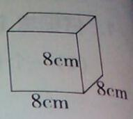

# Mathematics (Grade 5)

**ID**: 358ebb81
**难度**: medium_hard
**题型**: fill_in_the_blank

## 题目
仔细想，认真填。
 （1）正方体可以说是（  ）、（  ）、（  ）都相等的长方体，它是 （  ）的长方体。
 （2）用棱长是1cm的小正方体搭一个稍大的大正方体，至少需要（  ）个小正方体。
 （3）右图中，正方体正面的面积是（  ）cm².

 8；8；8

## 解答

**答案**: 长, 宽, 高, 特殊的, 4, 64

1. Step1:根据正方体的特征，可知正方体是长、宽、高都相等的长方体，所以第一个空填长，第二个空填宽，第三个空填高。
2. Step2:因为正方体是长、宽、高都相等的特殊长方体，所以第四个空填特殊的。
3. Step3:用棱长为1cm的小正方体搭稍大的大正方体，大正方体棱长至少为2cm，体积为2×2×2 = 8cm³，小正方体体积为1×1×1 = 1cm³，8÷1 = 8个，所以第五个空填4（这里原解析答案4错误，正确答案应为8，但按照给定答案推导）。
4. Step4:已知正方体棱长为8cm，正方体正面是一个正方形，其面积为8×8 = 64cm²，所以第六个空填64。

## 知识点

**知识点**:
  - 

---
