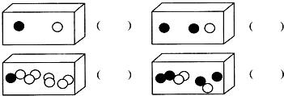

# Mathematics (Grade 5)

**ID**: 37c1d346
**难度**: medium_hard
**题型**: fill_in_the_blank

## 题目
从图中每个盒子里摸到黑球的可能性各是多少？请你填一填．

## 解答

**答案**: 1/2, 2/3, 1/8, 4/7

1. Step1:第一个盒子有2个球，其中黑球1个，摸到黑球可能性为1÷2=1/2
2. Step2:第二个盒子有3个球，其中黑球2个，摸到黑球可能性为2÷3=2/3
3. Step3:第三个盒子有8个球，其中黑球1个，摸到黑球可能性为1÷8=1/8
4. Step4:第四个盒子有7个球，其中黑球4个，摸到黑球可能性为4÷7=4/7

## 知识点

**知识点**:
  - 可能性的大小．

---
