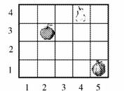

# Mathematics (Grade 5)

**ID**: 38fa49c1
**难度**: medium_hard
**题型**: fill_in_the_blank

## 题目
如图苹果的位置为（2， 3），则梨的位置可以表示为（，），西瓜的位置记为（，）

## 解答

**答案**: 4, 4, 5, 1

1. Step1:明确数对表示位置的规则，数对中第一个数表示列，第二个数表示行
2. Step2:观察梨的位置，其在第4列第4行，根据规则可得梨的位置用数对表示为(4, 4)，提取数对中的数字4、4
3. Step3:观察西瓜的位置，其在第5列第1行，根据规则可得西瓜的位置用数对表示为(5, 1)，提取数对中的数字5、1

## 知识点

**知识点**:
  - 用数对确定位置

---
