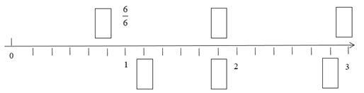

# Mathematics (Grade 5)

**ID**: 3accc8c1
**难度**: medium_hard
**题型**: fill_in_the_blank

## 题目
在直线上面的□里填上适当的真分数或假分数，下面的□里填上适当的带分数。

## 解答

**答案**: \\frac{5}{6}, \\frac{11}{6}, \\frac{18}{6}, 1\\frac{1}{6}, 1\\frac{5}{6}, 2\\frac{5}{6}

1. Step1:观察直线，从0到1被平均分成了6份，那么每一份是\(rac{1}{6}\)。
2. Step2:直线上面第一个空在0到1之间，是第5份，所以应填\(rac{5}{6}\)。
3. Step3:直线上面第二个空在1到2之间，1可以写成\(rac{6}{6}\)，从1开始数到这个空是第5份，总共是\(6 + 5 = 11\)份，所以应填\(rac{11}{6}\)。
4. Step4:直线上面第三个空在2到3之间，2可以写成\(rac{12}{6}\)，从2开始数到这个空是第6份，总共是\(12 + 6 = 18\)份，所以应填\(rac{18}{6}\)。
5. Step5:直线下面第一个空在1后面第1份，写成带分数是\(1rac{1}{6}\)。
6. Step6:直线下面第二个空在1后面第5份，写成带分数是\(1rac{5}{6}\)。
7. Step7:直线下面第三个空在2后面第5份，写成带分数是\(2rac{5}{6}\)。

## 知识点

**知识点**:
  - 

---
