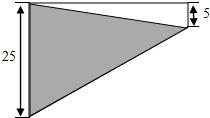

# Mathematics (Grade 5)

**ID**: 40621585
**难度**: medium_hard
**题型**: fill_in_the_blank

## 题目
如图，梯形的面积是450$cm^{2}$，阴影部分的面积是$\underline{\hspace{2em}}\underline{\hspace{2em}}\underline{\hspace{2em}}．$

## 解答

**答案**: 375平方厘米

1. Step1:根据梯形面积公式$S=(a + b)h÷2$（其中$S$是梯形面积，$a$、$b$是梯形上下底，$h$是梯形高），已知梯形面积$S = 450cm^{2}$，上底$a = 5cm$，下底$b = 25cm$，可得求梯形高$h$的式子$h = 450×2÷(5 + 25)$
2. Step2:计算$450×2÷(5 + 25)$，先算括号里$5 + 25 = 30$，再算$450×2 = 900$，最后$900÷30 = 30$厘米，即梯形的高为30厘米
3. Step3:因为梯形和阴影部分（三角形）的高相等，根据三角形面积公式$S = ah÷2$（其中$S$是三角形面积，$a$是三角形底，$h$是三角形高），阴影部分三角形底为25厘米，高为30厘米，可得阴影部分面积式子$25×30÷2$
4. Step4:计算$25×30÷2$，先算$25×30 = 750$，再算$750÷2 = 375$平方厘米，即阴影部分面积是375平方厘米

## 知识点

**知识点**:
  - 三角形的周长和面积;梯形的面积．

---
