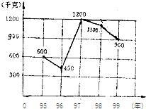

# Mathematics (Grade 5)

**ID**: 41b1c4b9
**难度**: medium_hard
**题型**: fill_in_the_blank

## 题目

(2013•张掖)看图回答
试验田玉米年产量统计图如图：
①产量最高的年份是______年，年产量是______千克．
②产量最低的年份是______年，年产量是______千克．

## 解答

**答案**: 97, 1200, 96, 450

1. Step1:观察试验田玉米年产量统计图，寻找产量最高的年份及对应年产量
2. Step2:从图中可知产量最高的年份是97年，年产量是1200千克
3. Step3:再次观察统计图，寻找产量最低的年份及对应年产量
4. Step4:从图中得出产量最低的年份是96年，年产量是450千克

## 知识点

**知识点**:
  - 单式折线统计图;从统计图表中获取信息．

---
