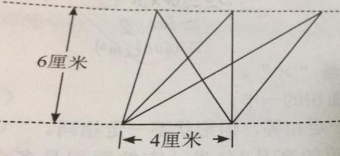

# Mathematics (Grade 5)

**ID**: 4273e8a2
**难度**: medium_hard
**题型**: fill_in_the_blank

## 题目
计算下面三个顶点在徐线上的三角形的面积，你发现了什么？

 6厘米 4厘米
 发现：______．

## 解答

**答案**: 三角形的面积只和底和高的长度有关，与三角形的形状无关

1. Step1:观察图形，发现三个三角形顶点在平行线上，且它们有相同的底为4厘米，相同的高为6厘米
2. Step2:根据三角形面积公式S = 底×高÷2，计算其中一个三角形面积为4×6÷2 = 12平方厘米
3. Step3:因为三个三角形底和高都相同，所以它们面积都为12平方厘米
4. Step4:又因为三个三角形形状不同但面积相同，所以得出三角形的面积只和底和高的长度有关，与三角形的形状无关

## 知识点

**知识点**:
  - --

---
