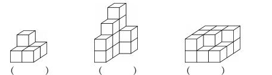

# Mathematics (Grade 5)

**ID**: 44bd2259
**难度**: medium_hard
**题型**: fill_in_the_blank

## 题目
下面的图形都是由棱长为1cm的正方体拼成的，它们的体积分别是多少？

## 解答

**答案**: 5cm^3, 11cm^3, 15cm^3

1. Step1:明确棱长为1cm的正方体体积是1cm³
2. Step2:数图形1，第一层有4个小正方体，第二层有1个小正方体，共1+4=5个小正方体，其体积是5cm³
3. Step3:数图形2，第一层有4个小正方体，第二层有4个小正方体，第三层有2个小正方体，第四层有1个小正方体，共1+2+4+4=11个小正方体，其体积是11cm³
4. Step4:数图形3，第一层有9个小正方体，第二层有6个小正方体，共6+9=15个小正方体，其体积是15cm³

## 知识点

**知识点**:
  - 组合图形的计数(奥数);长方体和正方体的体积

---
