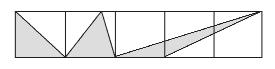

# Mathematics (Grade 5)

**ID**: 4d57c807
**难度**: medium_hard
**题型**: fill_in_the_blank

## 题目
下图中每个小正方形的面积都是25平方厘米，阴影部分的面积是多少？

## 解答

**答案**: 37.5

1. Step1:根据已知每个小正方形面积是25平方厘米，且三角形面积是和它等底等高的正方形面积的一半，可知每个阴影三角形面积为25÷2=12.5平方厘米
2. Step2:数出图中阴影三角形有3个
3. Step3:计算阴影部分总面积为12.5×3=37.5平方厘米

## 知识点

**知识点**:
  - 三角形的面积

---
