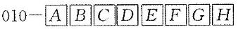

# Mathematics (Grade 5)

**ID**: 4d847f24
**难度**: medium_hard
**题型**: fill_in_the_blank

## 题目
猜电话号码.

 A—— 最小的奇数的5倍；
 B—— 既是8的因数又是8的倍数；
 C—— 是一位数，并有因数3的偶数；
 D—— 最大的一位数；
 E—— 最小的质数；
 F—— 最小的合数；
 G—— 既是质数又是偶数的数；
 H—— 10以内最大的质数；
 这个电话号码是(   )

## 解答

**答案**: 5, 8, 6, 9, 2, 4, 2, 7

1. Step1:确定A的值，最小的奇数是1，它的5倍为1×5=5，所以A是5
2. Step2:确定B的值，一个数既是它本身的因数又是它本身的倍数，所以既是8的因数又是8的倍数的数是8，B是8
3. Step3:确定C的值，一位数中有因数3的偶数，满足条件的是6，C是6
4. Step4:确定D的值，最大的一位数是9，D是9
5. Step5:确定E的值，最小的质数是2，E是2
6. Step6:确定F的值，最小的合数是4，F是4
7. Step7:确定G的值，既是质数又是偶数的数是2，G是2
8. Step8:确定H的值，10以内最大的质数是7，H是7

## 知识点

**知识点**:
  - 总复习-因数和倍数
-

---
