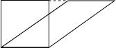

# Mathematics (Grade 5)

**ID**: 53e8f63c
**难度**: medium_hard
**题型**: fill_in_the_blank

## 题目
如图，如果正方形的周长是20厘米，平行四边形的面积是$\underline{\hspace{5em}}$平方厘米．

## 解答

**答案**: 25

1. Step1:根据正方形周长公式，已知正方形周长为20厘米，计算其边长，即20÷4 = 5厘米
2. Step2:观察图形可知平行四边形的底和高都等于正方形的边长，均为5厘米
3. Step3:根据平行四边形面积公式，计算其面积为5×5 = 25平方厘米

## 知识点

**知识点**:
  - 平行四边形的面积．

---
