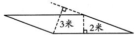

# Mathematics (Grade 5)

**ID**: 5d5eb730
**难度**: medium_hard
**题型**: fill_in_the_blank

## 题目
右图中平行四边形的面积是18平方米，两组对边间的距离分别是2米和3米，这个平行四边形的周长是(  )。

## 解答

**答案**: 30

1. Step1:根据平行四边形面积公式，用面积18平方米除以高2米，可得对应的底边长度为18÷2 = 9米
2. Step2:用面积18平方米除以高3米，可得对应的底边长度为18÷3 = 6米
3. Step3:平行四边形的周长等于相邻两边之和乘以2，所以周长为(6 + 9)×2
4. Step4:计算(6 + 9)×2 = 15×2 = 30米

## 知识点

**知识点**:
  - 平行四边形的面积;平行四边形的认识

---
