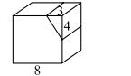

# Mathematics (Grade 5)

**ID**: 61fb1724
**难度**: medium_hard
**题型**: fill_in_the_blank

## 题目
在一个棱长为8的正方体上切去一个三棱柱（ 如图），那么表面积减少 $\underline{\hspace{5em}}$ 。

## 解答

**答案**: 28

1. Step1:在切去的三棱柱底面直角三角形中，已知直角边分别是3、4，根据勾股定理$a^2 + b^2 = c^2$（其中$a$、$b$为直角边，$c$为斜边），可得斜边长度为$\sqrt{3^{2}+4^{2}} = 5$
2. Step2:分析表面积减少部分，包括两个直角三角形的面积和长为8，宽为(3 + 4 - 5)的长方形的面积
3. Step3:计算两个直角三角形的面积，一个直角三角形面积为$3×4÷2$，则两个直角三角形面积为$3×4÷2×2 = 12$
4. Step4:计算长为8，宽为(3 + 4 - 5)的长方形的面积，即$(3 + 4 - 5)×8 = 2×8$
5. Step5:将长方形面积与两个直角三角形面积相加，得到减少的表面积为$16 + 12 = 28$

## 知识点

**知识点**:
  - 有余数的除法应用题

---
