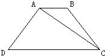

# Mathematics (Grade 5)

**ID**: 6449cf5f
**难度**: medium_hard
**题型**: fill_in_the_blank

## 题目
已知图中梯形ABCD的下底是上底的3倍，梯形ABCD的面积是100平方厘米，那么三角形ABC的面积是$\underline{\hspace{5em}}$平方厘米．

## 解答

**答案**: 25

1. Step1:设梯形上底为x厘米，根据下底是上底的3倍，得出下底为3x厘米
2. Step2:根据梯形面积公式S=(a + b)h÷2，将上底x、下底3x代入，得到(x + 3x)×h÷2 = 100
3. Step3:化简方程(x + 3x)×h÷2 = 100，即4xh÷2 = 100，进一步得到4xh = 200
4. Step4:求解xh的值，由4xh = 200，可得xh = 200÷4 = 50
5. Step5:根据三角形面积公式S = ah÷2，对于三角形ABC，其底为上底x，高为h，所以面积为xh÷2
6. Step6:将xh = 50代入三角形ABC面积公式xh÷2，得到50÷2 = 25平方厘米

## 知识点

**知识点**:
  - 三角形的周长和面积．

---
