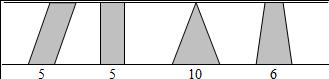

# Mathematics (Grade 5)

**ID**: 65e36444
**难度**: medium_hard
**题型**: fill_in_the_blank

## 题目
图中平行线间的4个图形，它们的面积都相等． $\underline{\hspace{5em}}$ （判断对错）

## 解答

**答案**: ×

1. Step1:因为夹在两平行线之间的距离相等，所以这4个图形的高相等，设高为h
2. Step2:根据平行四边形面积公式S = ah，第一个平行四边形底为5，高为h，其面积为5h
3. Step3:同理，第二个平行四边形底为5，高为h，面积也为5h
4. Step4:依据三角形面积公式S = ah÷2，第三个三角形底为10，高为h，面积是10h÷2 = 5h
5. Step5:按照梯形面积公式S = (a + b)×h÷2，第四个梯形只知下底为6，上底未知，不能确定其面积
6. Step6:由于第四个梯形面积不能确定，所以说4个图形面积都相等是错误的

## 知识点

**知识点**:
  - 平行四边形的面积;三角形的周长和面积;梯形的面积

---
