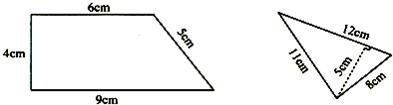

# Mathematics (Grade 5)

**ID**: 67582b8b
**难度**: medium_hard
**题型**: fill_in_the_blank

## 题目
选择合适的条件计算下面各图形的面积．

       面积$\underline{\hspace{5em}}$                               面积$\underline{\hspace{5em}}$．

## 解答

**答案**: 30平方厘米, 30平方厘米

1. Step1:对于梯形，明确其上底为6厘米，下底为9厘米，高为4厘米
2. Step2:根据梯形面积公式S=(a + b)×h÷2（其中a为上底，b为下底，h为高），计算(6 + 9)×4÷2，先算括号内6 + 9 = 15，再算15×4 = 60，最后60÷2 = 30平方厘米
3. Step3:对于三角形，明确其底为12厘米，高为5厘米
4. Step4:根据三角形面积公式S = a×h÷2（其中a为底，h为高），计算12×5÷2，先算12×5 = 60，再算60÷2 = 30平方厘米

## 知识点

**知识点**:
  - 梯形的面积；三角形的周长和面积．

---
