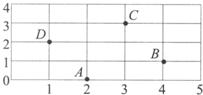

# Mathematics (Grade 5)

**ID**: 6c32dee7
**难度**: medium_hard
**题型**: fill_in_the_blank

## 题目
如图所示，若A的位置用（2，0）表示，则B的位置用（$\underline{\hspace{5em}}$，$\underline{\hspace{5em}}$）表示，C 的位置用（$\underline{\hspace{5em}}$，$\underline{\hspace{5em}}$）表示，D的位置用（$\underline{\hspace{5em}}$，$\underline{\hspace{5em}}$）表示．

## 解答

**答案**: 4, 1, 3, 3, 1, 2

1. Step1:根据数对表示的意义，前面的数表示列，后面的数表示行。观察B点，其在第4列第1行，所以B的位置用（4，1）表示
2. Step2:观察C点，其在第3列第3行，所以C的位置用（3，3）表示
3. Step3:观察D点，其在第1列第2行，所以D的位置用（1，2）表示
4. Step4:将B、C、D位置数对中的数字依次提取出来，得到['4', '1', '3', '3', '1', '2']

## 知识点

**知识点**:
  - 数对与位置．

---
