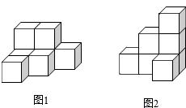

# Mathematics (Grade 5)

**ID**: 7303befd
**难度**: medium_hard
**题型**: fill_in_the_blank

## 题目
数一数有多少个小正方体？
图1中有 $\underline{\hspace{5em}}$ 个
图2中有 $\underline{\hspace{5em}}$ 个．

## 解答

**答案**: 8, 7

1. Step1:分析图1，可知图1有2层，下层有6个小正方体，中间层有2个小正方体
2. Step2:计算图1小正方体个数，6 + 2 = 8个
3. Step3:分析图2，可知图2有3层，下层有4个小正方体，中间层有2个小正方体，上层有1个小正方体
4. Step4:计算图2小正方体个数，4 + 2 + 1 = 7个

## 知识点

**知识点**:
  - 简单的立方体切拼问题

---
